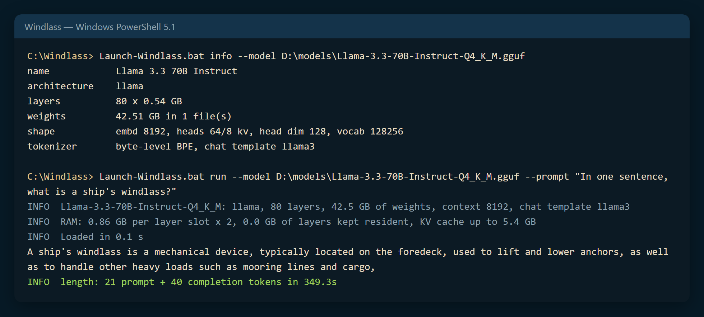
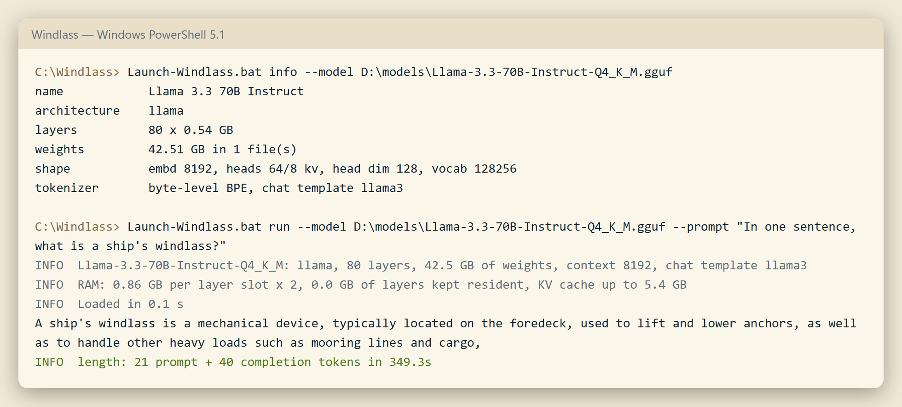

<p align="center">
  <picture>
    <source media="(prefers-color-scheme: dark)" srcset="assets/brand/emblem-dark.png">
    
  </picture>
</p>

# Windlass

Run very large local models (70B and up) on an ordinary Windows PC by streaming them through memory one layer at a time, behind an OpenAI-compatible API.

**Status: v0.2, engineering preview, CPU only.** Part of the [FleetHacker Edge-Ops suite](https://github.com/fleethacker-data-crucible/edge-ops).

## The name

A *windlass* is the heavy winch at a ship's bow that hauls the anchor chain in link by link. It is slow, but it lifts what nothing else on board can. Windlass does the same with a huge model: it hauls the model through memory one layer at a time, so a PC that could never hold the whole model can still run it. No former names.

| Night watch (dark) | Chart room (light) |
| --- | --- |
|  |  |

## Run it

1. Download or clone the folder, then **Unblock** it if it came as a zip. No admin rights, installs or network access needed.
2. Put a GGUF model on your fastest drive, for example `D:\models\Llama-3.3-70B-Instruct-Q4_K_M.gguf`. Windlass reads files only; it never downloads anything.
3. In a console:

   ```bat
   Launch-Windlass.bat serve --model D:\models\Llama-3.3-70B-Instruct-Q4_K_M.gguf
   ```

4. The API answers on **`http://127.0.0.1:8777/v1`** (the first free port in 8777-8779). The console shows the log.
5. To stop: **Ctrl+C**, or `src\Stop-Windlass.ps1`.

Windlass sets itself up for the computer it runs on (free RAM, cores, battery): `Launch-Windlass.bat playbook probe --model <file>` measures this computer once and shows the settings it picked and why. Before a long run, `Launch-Windlass.bat info --model <file>` prints the model's shape and the RAM it needs, and `Launch-Windlass.bat run --model <file> --prompt "Hi"` gives one reply in the console. All commands and options: [docs/USAGE.md](docs/USAGE.md).

## What it does

- **Runs models bigger than your GPU or RAM.** Only about two layers are in memory at once, and the next one is read while the current one computes. A 70B Q4_K_M model needs about 2 GB plus the KV cache.
- **Llama 2/3, Mistral, Qwen2/2.5 and dense Qwen3** GGUF files in the usual quantizations (`Q8_0` to `Q2_K`) and in the I-quants (`IQ4_NL`, `IQ4_XS`, `IQ3_XXS`, `IQ3_S`, `IQ2_XXS`, `IQ2_XS`, `IQ2_S`, `IQ1_S`, `IQ1_M`; reference ports of llama.cpp's decoders, not yet logit-checked against llama.cpp, see [docs/USAGE.md](docs/USAGE.md#models)), with built-in tokenizers and chat templates.
- **Granite 3 dense and OLMo 2** (`granite`, `olmo2`): the forward pass is tested against an independent reference, not against llama.cpp, and their chat templates and pre-tokenizers are not built in yet ([docs/USAGE.md](docs/USAGE.md#models)).
- **Mixture-of-experts models** (Mixtral-style `llama`, `qwen2moe`, `qwen3moe`): only the chosen experts compute, but a layer still streams every expert. Tested against an independent reference on tiny models; not yet logit-checked against llama.cpp on a real MoE file.
- **OpenAI-compatible API**: chat completions with streaming, usage, keepalives during long layer passes, a FIFO queue and cancel on disconnect ([docs/API.md](docs/API.md)).
- **Publishes what it measured.** `GET /v1/models` carries a `windlass` object with seconds per token and per prompt token (predicted and observed), the limiting resource, perplexity (`playbook eval`) and a context-fidelity score (`playbook fidelity`), `null` where never measured, so a router can choose without guessing ([docs/API.md](docs/API.md#measured-numbers-in-v1models), [docs/SPEED-QUALITY.md](docs/SPEED-QUALITY.md)).
- **Optional batching** (`serve --batch N`): up to N requests generate together, one pass over the layers per step for all of them, with the same replies as one at a time. Off by default; each slot adds a KV cache of RAM; the throughput gain is unmeasured ([docs/USAGE.md](docs/USAGE.md#batching)).
- **Fairlead's `deep-local` route.** Register Windlass in Fairlead as a local provider, reachable only by name, so interactive tools never wait on it.
- **Slow by design.** Measured on a Ryzen 9 9950X3D with 96 GB RAM: about 8.7 s per token for Llama 3.3 70B, 0.75 s per token for Llama 3.2 3B. Use it for batch and deep work, not chat ([docs/ARCHITECTURE.md](docs/ARCHITECTURE.md#speed)).

## Privacy and security

Windlass binds loopback only (`127.0.0.1` and `localhost`), checks every request's `Host` and `Origin`, and makes no outgoing connections: no process starts, no P/Invoke, no dynamic assembly loading. `Start-Windlass.ps1` checks the source for these before it compiles and refuses to start if any appear. Prompts and replies stay on the machine; the log records request ids, token counts and timings, not text. The API key (`--api-key`) is optional because only programs on this PC can reach the port; set one if other users share the PC. Model files are parsed defensively, but load only models you trust.

## Documentation

- [Usage: commands, options, models, requirements](docs/USAGE.md) · [API and Fairlead setup](docs/API.md) · [How it works, speed, roadmap](docs/ARCHITECTURE.md) · [Development and tests](docs/DEVELOPMENT.md) · [CLI and API parity](docs/CLI-API-PARITY.md) · [Lifecycle](docs/LIFECYCLE.md)
- [Engine briefing (one-page infographic)](docs/briefing/) · [Stress test: Llama 3.3 70B, phases 1–6](docs/STRESS-TEST.md) · [Changelog](CHANGELOG.md) · [Third-party notices](THIRD-PARTY.md)

## License

MIT. See [LICENSE](LICENSE). Algorithms ported from llama.cpp (MIT) and parts of Phoenix LAI (MIT); the layer-streaming idea comes from AirLLM. See [THIRD-PARTY.md](THIRD-PARTY.md).
