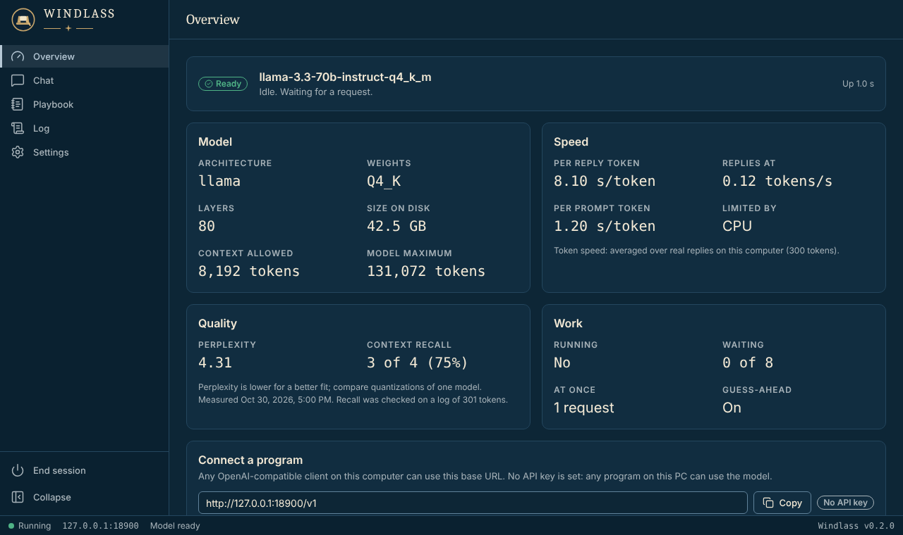
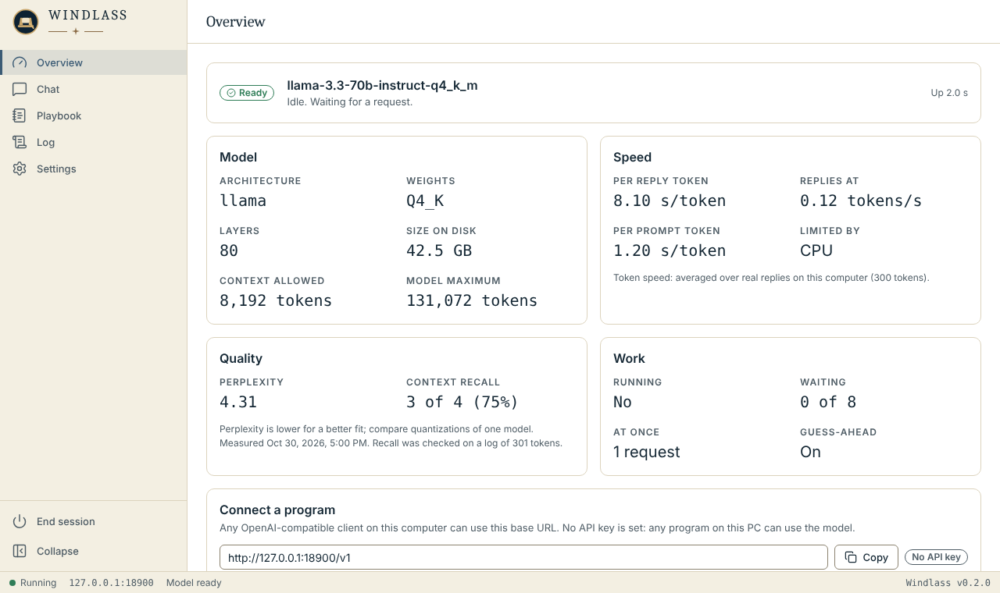

# The browser UI

Windlass serves a page for itself at **`http://127.0.0.1:8777/`** (the same port as the API, so the first free port of its
block, 8777-8779). It follows the Fleet Unified UI ([UNIFIED-UI.md](UNIFIED-UI.md)): Night watch and Chart room themes,
the 240 px sidebar, 56 px header and 28 px status bar, Lucide icons, WCAG 2.2 AA targets.

| Night watch (dark) | Chart room (light) |
| --- | --- |
|  |  |

(The screenshots show synthetic numbers from the UI's mock server, `ui-src\tools\mock-windlass.mjs`, not a measurement.)

## Starting it

```bat
Launch-Windlass.bat                                         :: asks for a .gguf file, then serves it and opens the UI
Launch-Windlass.bat serve --model D:\models\model.gguf --open   :: the same with the model on the command line
Launch-Windlass.bat serve --model D:\models\model.gguf          :: the API, as before; the page is at / but nothing opens
```

- **`--open`** opens your browser when the server answers (the launcher script does this; the engine never starts a
  process), and makes the tab own the server: closing it stops Windlass within about 5 seconds, a reload does not, and
  nothing stops while a reply is running or queued ([LIFECYCLE.md](LIFECYCLE.md)). Add `--no-auto-stop` (or
  `WINDLASS_AUTO_STOP=0`) to keep serving after the tab closes.
- Without `--open`, a server is never stopped by a tab: opening the page and closing it again leaves a Windlass that
  Fairlead or a script is using alone.
- **`--no-ui`** serves the API only. A folder `ui\dist` that is missing or has no `index.html` does the same, with a
  warning in the log.
- **A model is chosen at start.** The page cannot load or swap a model yet (the engine loads one at start). The file
  dialog of the no-argument launch remembers its folder in `playbooks\last-model.txt`.

## Pages

| Page | What it shows | The command or route behind it |
| --- | --- | --- |
| **Overview** | Model state (loading, ready, failed and why), architecture, quant, layers, size, context; seconds per token both ways, per prompt token, what limits it; perplexity and context recall; queue and batch; the base URL and the Fairlead steps | `GET /api/status` (the `windlass` object is the same as `GET /v1/models`), `playbook probe`, `playbook eval`, `playbook fidelity` |
| **Chat** | A conversation with the model, streamed, with Stop, a system prompt, max tokens, temperature and seed; while it waits it shows `accepted`, the keepalives and the time, and afterwards the first-token time and token counts | `POST /v1/chat/completions`, `run` |
| **Playbook** | The settings in use and why, this computer, the probe's measurements, what real replies taught it | `GET /api/playbook`, `playbook show` |
| **Log** | The last 500 lines of the server log (ids, token counts and timings; never prompts or replies), filterable, with Follow and Copy | `GET /api/logs`, the file in `logs\` |
| **Settings** | Theme, the server's settings as started (read-only), End session | `POST /api/shutdown`, `Stop-Windlass.ps1` |

Measuring (`probe`, `eval`, `fidelity`) stays a command: each reads the whole model from disk and takes minutes to hours. A
value that was never measured shows as **—** with the command that produces it, never as an estimate.

Keyboard: `?` lists the shortcuts, `g` then `o`, `c`, `p`, `l` or `s` goes to a page, `Ctrl+Enter` sends in Chat, `Esc`
closes a dialog.

## How it is served and kept local

- The files are the compiled output in `ui\dist`; Windlass lists them when it starts and serves a file only on an exact
  URL match and only for the types html, js, css, json, svg, png, ico, woff2 and txt, so no request text becomes a file path.
- Every page response carries a Content-Security-Policy of this origin only (`default-src 'none'; script-src 'self'; ...`),
  no inline script or style, `nosniff`, no referrer and no framing. `connect-src 'self'`: the page talks to nothing else.
- The loopback rules of the API apply to the page: `Host` and `Origin` are checked. The `/api/` routes answer this
  server's own origin only, not another loopback port.
- **Session token.** `POST /api/session` returns a random token that the other `/api/` routes need in an
  `X-Windlass-Session` header. When Windlass has an API key, `/api/session` needs it (`Authorization: Bearer`), so the page
  asks for the key once and keeps it for the tab (`sessionStorage`), never in `localStorage`. The page's files carry no
  secret, so they load without the key. The token opens `/api/` only, never `/v1`. The page-close beacon cannot set
  headers, so `/api/heartbeat` also accepts the token in its JSON body, on that one route.
- Browser storage keys start with `windlass-`: `windlass-theme`, `windlass-sidebar`, `windlass-max-tokens`. Chats are kept in
  the page's memory only.

## Building it

The page is built off the workstation and its compiled output is committed, as in Lazarette; the workstation needs no Node.

```bat
cd ui-src
npm ci
npm run build        :: -> ..\ui\dist
npm run check        :: svelte-check
npm test             :: Vitest: formatting, the SSE parser, the heartbeat
npm run test:e2e     :: Playwright against the mock server (needs a Chromium)
npm run mock         :: the mock server on 8777: node tools\mock-windlass.mjs --scenario ready|loading|error|key|bare
```

Stack: Svelte 5 + TypeScript, Tailwind CSS 4 on the shared `--fl-*` tokens (`ui-src\vendor\fleet\fleet.css`, identical in
every Fleet repo), Lucide icons bundled by Vite. No CDN, no runtime network call. Windlass's signature accent is chain-iron
steel (`#b7c9d6` Night watch, `#3b5b75` Chart room; 8.4 to 10.4 and 5.9 to 7.1 against the surfaces), set in `app.css`
and proposed for UNIFIED-UI.md section 3.3.
