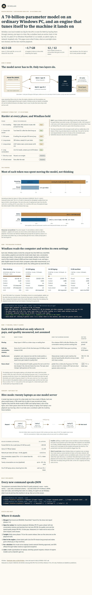

# Windlass engine briefing

A one-page technical infographic: how Windlass runs a 70B model on a CPU, what the overnight stress test showed, the
self-tuning machine playbook with its measured before/after, and the hive-mode concept for networked laptops.
Written for sharing with the team; current as of 28 October 2026.

- **[index.html](index.html):** the page itself. Download the folder and open it in a browser; it is self-contained
  (no web fonts, scripts or network requests) and follows the reader's light or dark theme.
- The screenshot below shows it on GitHub.

  <picture>
    <source media="(prefers-color-scheme: dark)" srcset="windlass-briefing-dark.png">
    
  </picture>

The page describes the machine playbook, guess-ahead and the quality score as work then in review; they were merged in
Windlass PRs #7, #8 and #9 and are in the code now.
